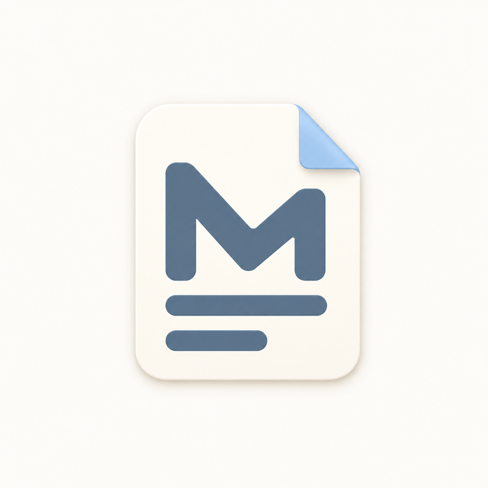
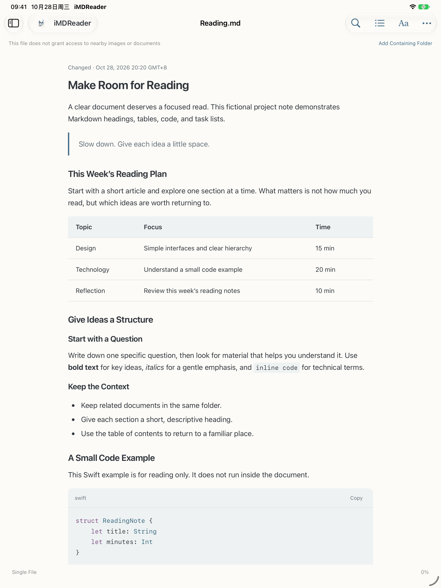
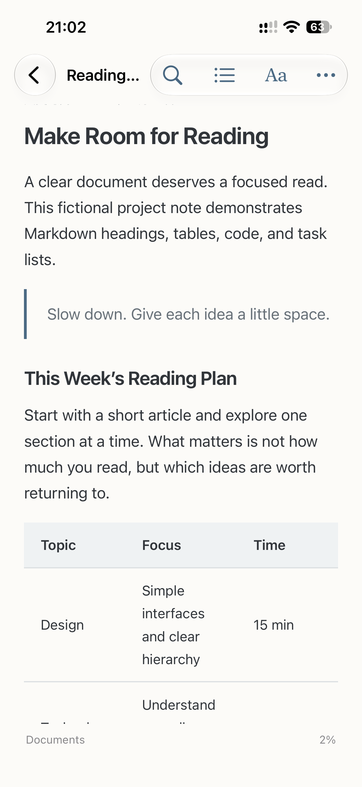

<h1 align="center">iMDReader</h1>

<a href="README.md">简体中文</a> · English

A lightweight, native, read-only Markdown reader for Mac, iPhone, and iPad. Open local files, folders, and GitHub documents while keeping the originals unchanged.

## Download

- **Mac:** [Download the 0.2.1 release](https://github.com/wivnelo/i-md-reader/releases/tag/v0.2.1). Supports Apple Silicon and Intel; requires macOS 14 or later.
- **iPhone / iPad:** 0.2.1 (51) has been submitted for App Store review and is not yet available.

For Mac, download the `.dmg`, open it, and drag iMDReader to Applications. A ZIP is also available. The release is Developer ID signed, notarized by Apple, and checked with Gatekeeper. You can replace an existing installation without uninstalling or clearing your library. Intel and macOS 14 have not been tested on physical hardware.

## Preview

<table><tr><td align="center"> iPad reading view</td><td align="center"> iPhone reading view</td></tr></table>

These are actual 0.2.1 (51) reading views from an iPad simulator and an iPhone. The iPad system status bar remains in Chinese.

## Start reading

1. Select **+** and choose a Markdown file, local folder, or GitHub link.
2. Open a document. Adding a folder preserves its hierarchy and lets you follow relative links within the authorized folder.
3. Use search, the table of contents, and **Aa** to tailor your reading experience. Reading positions are saved on your device.

Access to a single file does not grant access to its parent folder. Add the folder to read neighboring images or documents. iMDReader reads your files without editing, moving, or deleting them.

## Features

- **A comfortable reading view:** headings, tables, task lists, syntax highlighting, in-document search, and a table of contents, with adjustable type size and appearance.
- **Organize sources:** keep folder hierarchies, pin frequently used sources, and return to recent documents.
- **Read from GitHub:** open public repositories, subfolders, or individual documents. For private repositories, use your own fine-grained read-only token, stored in the device Keychain.
- **Read offline:** previously read GitHub content is available offline while cached. Uncached content still requires a network connection; the cache is not a complete repository backup.
- **Interface languages:** Simplified Chinese and English; document text and filenames are left unchanged.

## Help and feedback

- [Support](https://wivnelo.github.io/i-md-reader/support.html) · [Privacy policy](https://wivnelo.github.io/i-md-reader/privacy.html) · [Report an issue](https://github.com/wivnelo/i-md-reader/issues)
