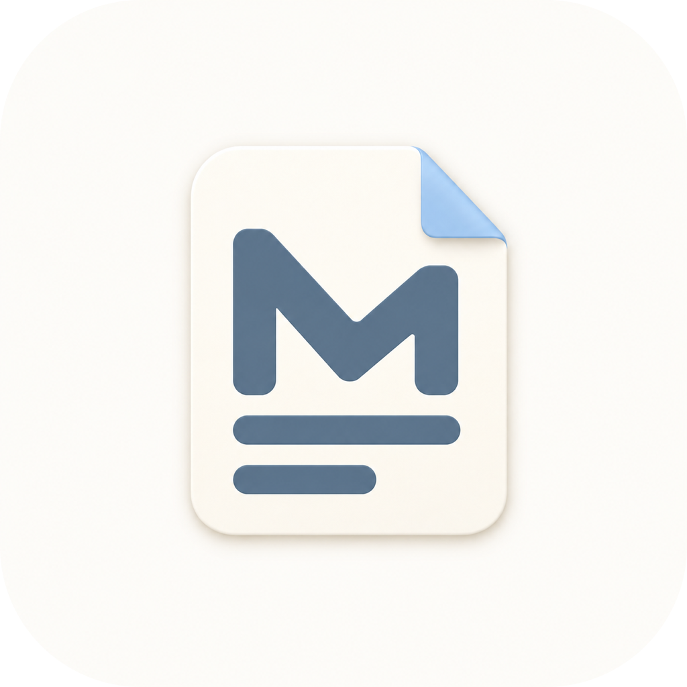
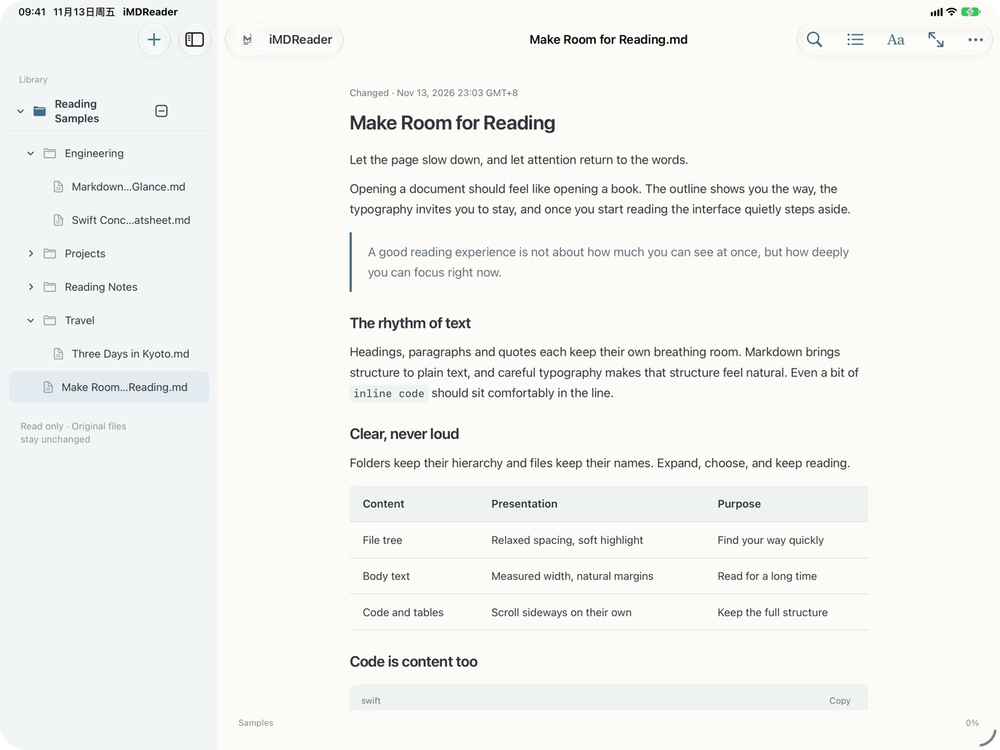
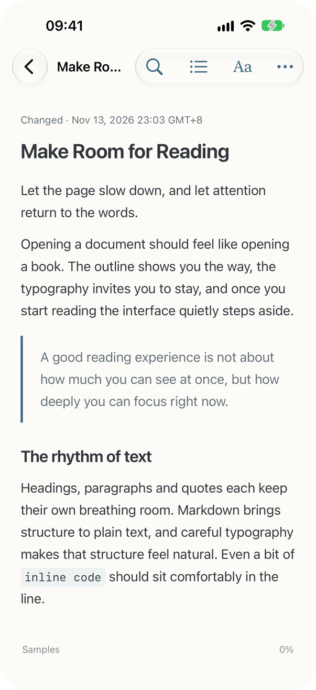
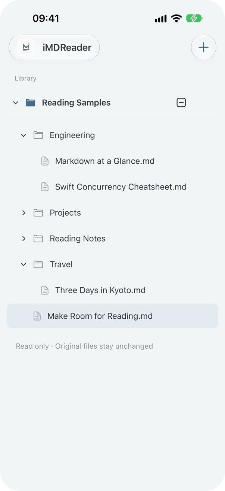
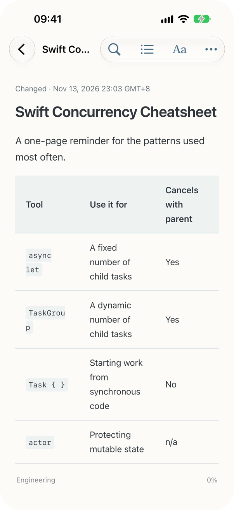
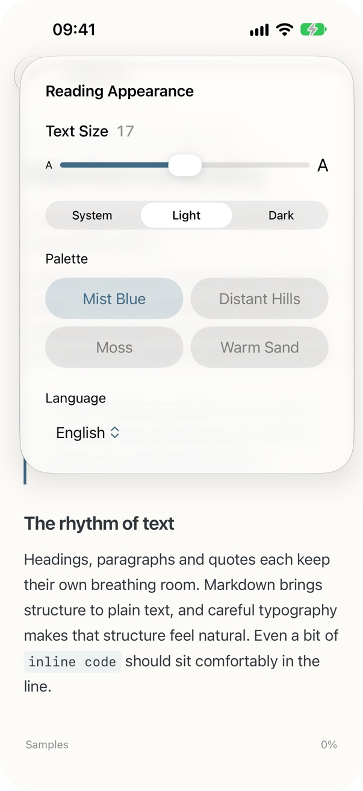
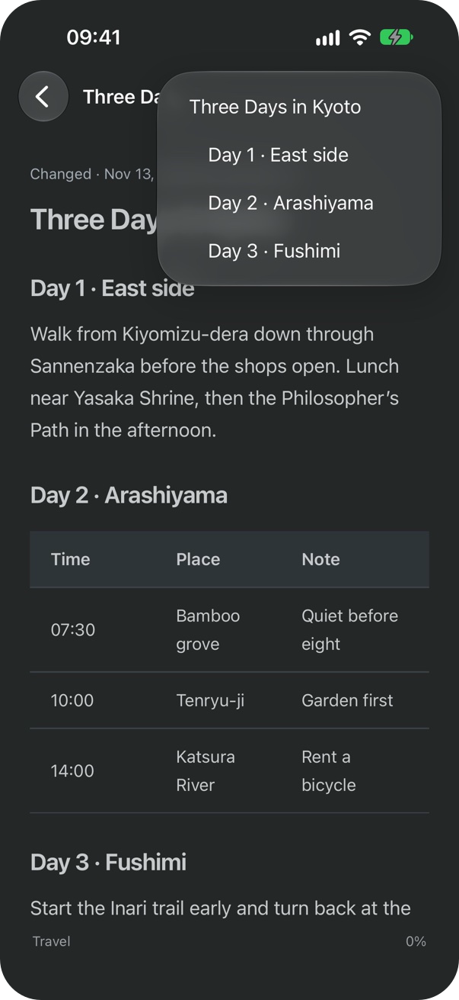
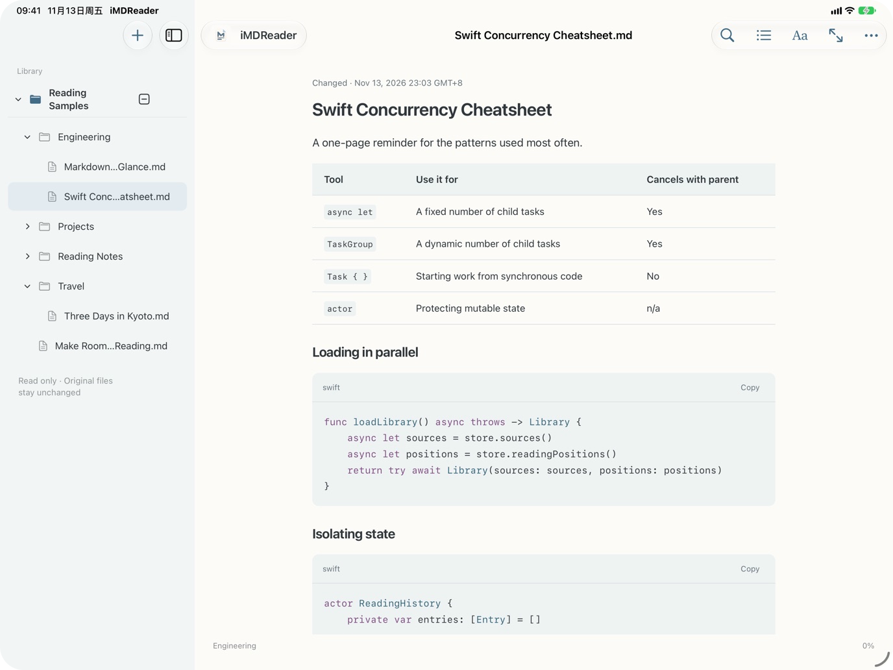
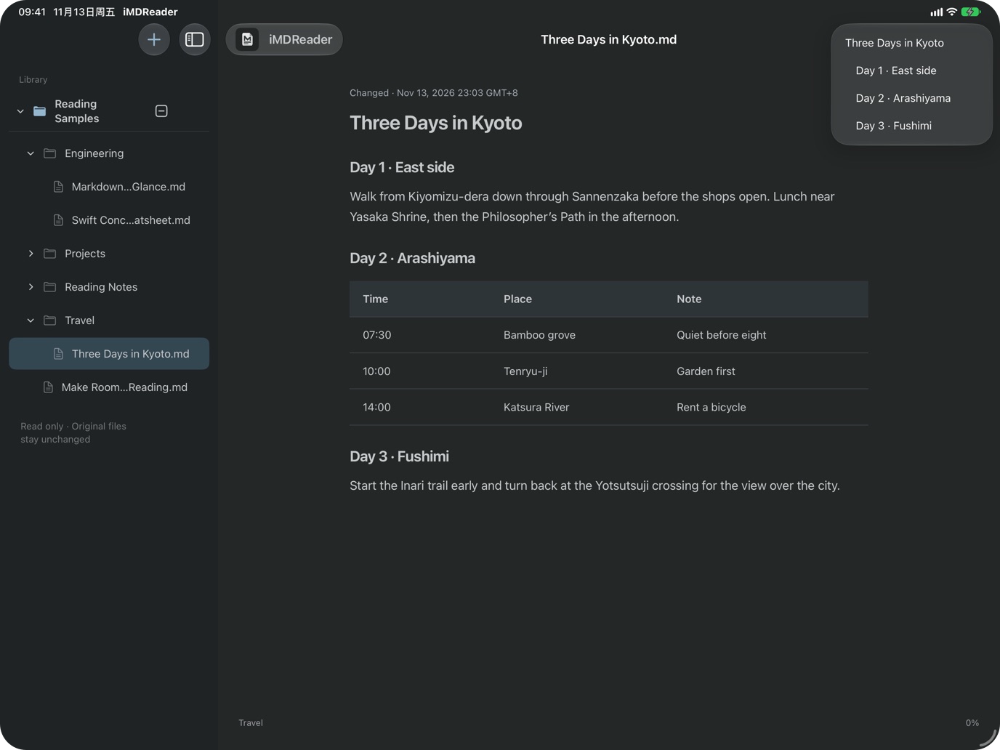

<h1 align="center">iMDReader</h1>

<a href="README.md">简体中文</a> · English

<b>Make room for reading.</b> A lightweight, native, read-only Markdown reader for Mac, iPhone, and iPad. Completely free. No in-app purchases. No data collection.

<a href="https://github.com/wivnelo/i-md-reader/releases/tag/v0.4.1">Download 0.4.1 for Mac</a> · <a href="https://apps.apple.com/app/id6827371085">App Store</a> · <a href="https://wivnelo.github.io/i-md-reader/">Website</a>

## Download

| Platform | Version | Requirements |
| --- | --- | --- |
| **Mac** | [0.4.1](https://github.com/wivnelo/i-md-reader/releases/tag/v0.4.1) (2026-11-14) | macOS 14 or later, Apple Silicon and Intel |
| **iPhone / iPad** | [App Store 0.4.0](https://apps.apple.com/app/id6827371085); 0.4.1 is about to be submitted | iOS / iPadOS 17 or later |

On Mac, download the `.dmg`, open it, and drag iMDReader to Applications. A ZIP is also available. The release is Developer ID signed, notarized by Apple, and checked with Gatekeeper. To update, quit iMDReader and replace the app; your library is kept. If the Dock still opens an older copy, remove that Dock item and pin iMDReader from Applications again.

## Preview

 

Captured from 0.4.0 in the iPhone 18 Pro and 13-inch iPad Pro simulators with sample documents: reading view, library, code and tables, Reading Appearance, and dark mode with the outline. The iPad status bar date appears in Chinese because of the simulator's system language.

## Start reading

1. Select **+** and choose a Markdown file, local folder, or GitHub link.
2. Open a document. Adding a folder preserves its hierarchy and lets you follow relative links within it.
3. Use search, the outline, and **Aa** to tailor your reading. Your reading position is saved automatically.

Access to a single file does not grant access to its parent folder. Add the folder to read neighboring images or documents. iMDReader reads your files without editing, moving, or deleting them.

## Features

### Reading

- Headings, tables, task lists, quotes, images, and code blocks, with syntax highlighting (including MATLAB) and one-tap copy.
- In-document search and an outline. Reading positions are remembered by paragraph, so you return to the same place on another device or after the window width changes.
- Text size from 12 to 26 pt, light, dark, or system appearance, and four reading palettes.
- HTML common in READMEs (centered headers, badges, `
` and more) renders safely the way GitHub does, and HTTPS images load directly.
- Glance at source and config files in a repository (Swift, Python, JavaScript/TypeScript, Go, Rust, the C family, JSON, YAML and more): read-only, with line numbers and syntax highlighting.

### Sources

- Individual Markdown files, local folders, and GitHub repositories, subfolders, or single documents, with their hierarchy intact.
- Pin the sources you read most and reorder the rest. Removing a source only removes it from the reader; original files are untouched.
- For private GitHub repositories, use your own fine-grained read-only token, stored in the device Keychain. Every request is read-only.
- GitHub content you have read is available offline while cached. The cache is not a full repository download; uncached content still needs a connection.

### Sync and system integration

- **iCloud sync:** Syncs sources, pins and order, and reading positions across devices on the same Apple Account; turn it off under “•••”. Data stays in your private iCloud; document text and tokens are never uploaded, and appearance settings stay per device.
- **iPhone and iPad:** A Continue Reading Home Screen widget, Spotlight search for documents you have read, and Shortcuts and Siri (“Continue Reading”, “Open Document”).
- **Mac:** A Universal native app. Right-click to pin or remove sources; the offline cache is managed automatically.

### Languages and privacy

- Interface in Simplified Chinese, Traditional Chinese, English, Japanese, and Korean, switchable anytime in Reading Appearance. Document text and filenames are left as they are.
- Completely free, with no in-app purchases, ads, or accounts. No data is collected, and code in documents is never executed.

## Help and feedback

[Support](https://wivnelo.github.io/i-md-reader/support.html) · [Privacy policy](https://wivnelo.github.io/i-md-reader/privacy.html) · [Report an issue](https://github.com/wivnelo/i-md-reader/issues)

**What's new in 0.4.1:** read code files with syntax highlighting and line numbers; HTTPS images in documents load, and HTML in READMEs displays the way GitHub shows it; better toolbar behavior when folding and unfolding iPhone Duo; a new drag-to-install window for the Mac DMG. Version 0.4.0 added Japanese, Korean, and Traditional Chinese and more reliable iCloud sync. Mac 0.4.1 was released on 2026-11-14; the App Store currently has 0.4.0 for iPhone and iPad, and 0.4.1 is about to be submitted. See [development status](docs/STATUS.md).
