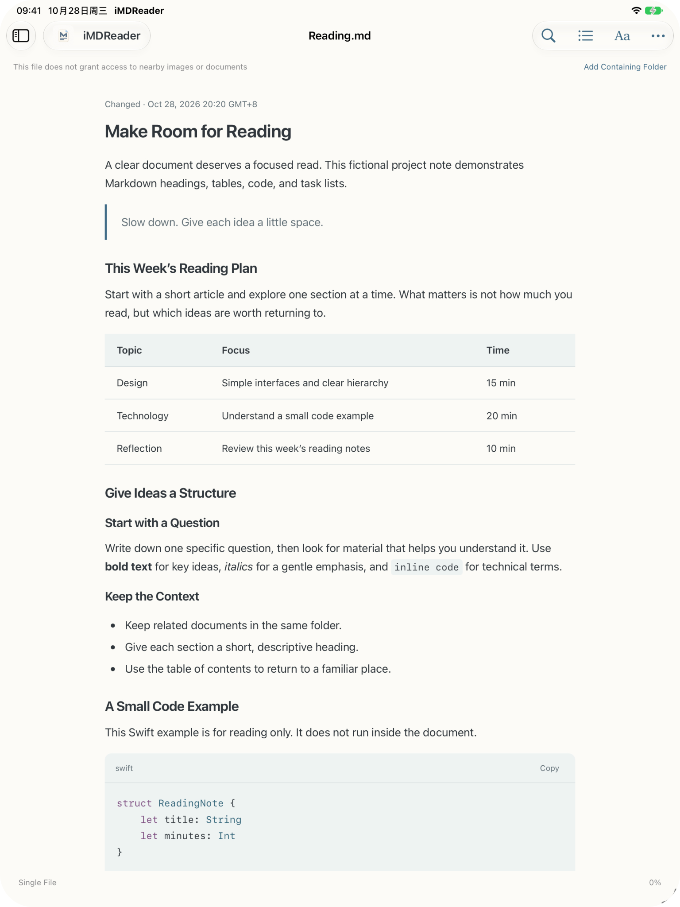
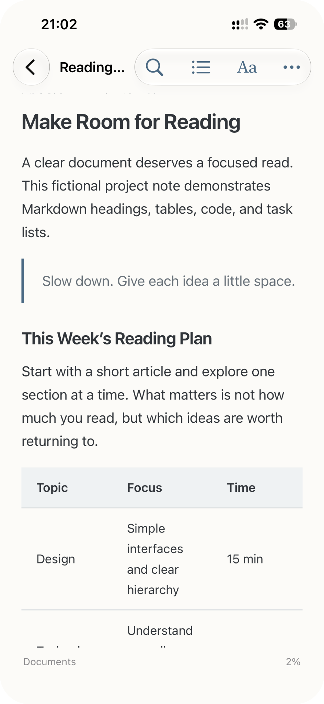

<h1 align="center">iMDReader</h1>

<a href="README.md">简体中文</a> · English

A lightweight, native, read-only Markdown reader for Mac, iPhone, and iPad.

## Download

- **Mac:** [Download the 0.3.0 release](https://github.com/wivnelo/i-md-reader/releases/tag/v0.3.0). Supports Apple Silicon and Intel; requires macOS 14 or later.
- **iPhone / iPad:** [Get 0.3.0 on the App Store](https://apps.apple.com/app/id6827371085), iOS / iPadOS 17 or later; includes iCloud sync, the Continue Reading widget, Spotlight and Shortcuts.

For Mac, download the `.dmg`, open it, and drag iMDReader to Applications. A ZIP is also available. The release is Developer ID signed, notarized by Apple, and checked with Gatekeeper. You can replace an existing installation without uninstalling or clearing your library. Quit iMDReader before replacing it, then open the copy in Applications. If the Dock still opens an older copy, remove that Dock item and pin iMDReader from Applications again.

## Preview

&nbsp;&nbsp;&nbsp;

These are actual 0.2.1 (51) reading views from an iPad simulator and an iPhone. The iPad system status bar remains in Chinese.

## Start reading

1. Select **+** and choose a Markdown file, local folder, or GitHub link.
2. Open a document. Adding a folder preserves its hierarchy and lets you follow relative links within the authorized folder.
3. Use search, the table of contents, and **Aa** to tailor your reading experience. Reading positions are saved on your device.

Access to a single file does not grant access to its parent folder. Add the folder to read neighboring images or documents. iMDReader reads your files without editing, moving, or deleting them.

## Features

- **A comfortable reading view:** headings, tables, task lists, syntax highlighting, in-document search, and a table of contents, with adjustable type size and appearance.
- **Organize sources:** keep folder hierarchies, pin frequently used sources, and return to recent documents.
- **Read from GitHub:** open public repositories, subfolders, or individual documents. For private repositories, use your own fine-grained read-only token, stored in the device Keychain.
- **Read offline:** previously read GitHub content is available offline while cached. Uncached content still requires a network connection; the cache is not a complete repository backup.
- **iCloud sync:** Syncs sources, pins and order, and reading positions across devices on the same Apple Account; turn it off under “•••”. Document text is never uploaded, and local folders outside iCloud Drive stay on the device.
- **Interface languages:** Simplified Chinese and English; document text and filenames are left unchanged.

## Help and feedback

- [Support](https://wivnelo.github.io/i-md-reader/support.html) · [Privacy policy](https://wivnelo.github.io/i-md-reader/privacy.html) · [Report an issue](https://github.com/wivnelo/i-md-reader/issues)

The public release remains 0.3.0. A 14-day trial and one-time unlock for iPhone and iPad are in development and testing, and have not been publicly released. Mac remains free. The approved paywall has been implemented natively. Local purchase-flow and paywall checks on short-screen iPhone and iPad simulators are complete, with additional full-app navigation and purchase-gate regression checks. The approved contrast adjustment for four text controls on the light-mode locked screen is implemented. The latest fixes are available in TestFlight as 0.4.0 (55), but product loading still fails on a real device and the Paid Apps Agreement is not yet active. The old lock screen has been removed and the affected regression checks have passed locally; this change has not been uploaded. Overall acceptance and real-device transactions are not complete. See [development status](docs/STATUS.md) and [IAP implementation](docs/IAP.md).
