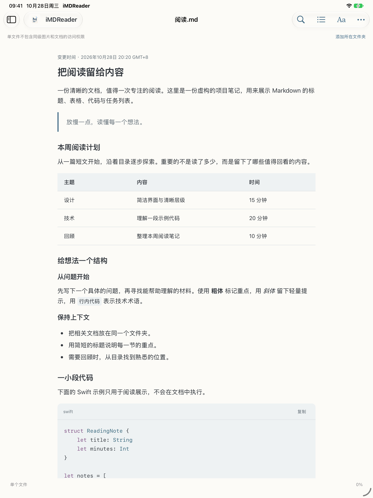
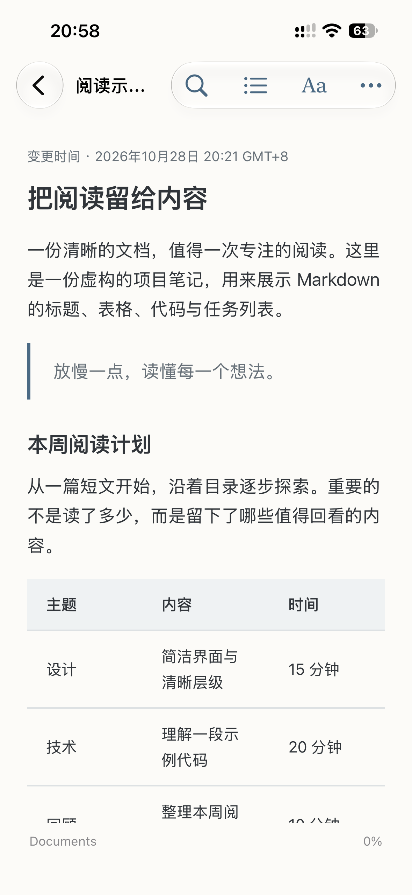

<h1 align="center">iMDReader</h1>

简体中文 · <a href="README.en.md">English</a>

轻量、原生、只读的 Markdown 阅读器，适用于 Mac、iPhone 和 iPad。打开本地文件、文件夹或 GitHub 文档，专注阅读，保留原文件。

## 下载

- **Mac：** [下载 0.2.1 正式版](https://github.com/wivnelo/i-md-reader/releases/tag/v0.2.1)。支持 Apple Silicon 和 Intel，系统要求 macOS 14 或更高版本。
- **iPhone / iPad：** 0.2.1（51）已提交 App Store 审核，尚未上架。

Mac 推荐下载 `.dmg`，打开后将 iMDReader 拖入“应用程序”；也可下载 ZIP。发行包已通过 Developer ID 签名、Apple 公证和 Gatekeeper 检查。更新时无需卸载，保留已有资料库。Intel 和 macOS 14 尚未实机验证。

## 预览

<table><tr><td align="center"> iPad 阅读页面</td><td align="center"> iPhone 阅读页面</td></tr></table>

以上为 0.2.1（51）实际阅读界面，分别来自 iPad 模拟器和 iPhone 真机。

## 开始阅读

1. 点击 **＋**，选择 Markdown 文件、本地文件夹或 GitHub 链接。
2. 选择文档开始阅读；添加文件夹可保留目录层级和文档间的相对链接。
3. 使用搜索、目录和 **Aa** 调整阅读方式；阅读位置会在本机保存。

单独授权文件不会自动授权其所在文件夹；如需读取同级图片或文档，请添加所在文件夹。iMDReader 只读取内容，不修改、移动或删除源文件。

## 功能

- **舒适阅读：** 支持标题、表格、任务列表、代码高亮、文内查找和目录；可调整字号、明暗和配色。
- **管理来源：** 保留文件夹层级、置顶常用来源，并快速回到最近阅读的文件。
- **GitHub 阅读：** 支持公开仓库、子目录和单篇文档；私有仓库可使用自己的细粒度只读令牌，令牌保存在设备 Keychain。
- **离线阅读：** 已读取的 GitHub 内容在缓存可用时可离线查看；未缓存内容仍需网络，缓存不等于完整仓库备份。
- **界面语言：** 简体中文和 English；文档内容和文件名保持原样。

## 帮助与反馈

- [使用支持](https://wivnelo.github.io/i-md-reader/support.html) · [隐私政策](https://wivnelo.github.io/i-md-reader/privacy.html) · [提交问题](https://github.com/wivnelo/i-md-reader/issues)
