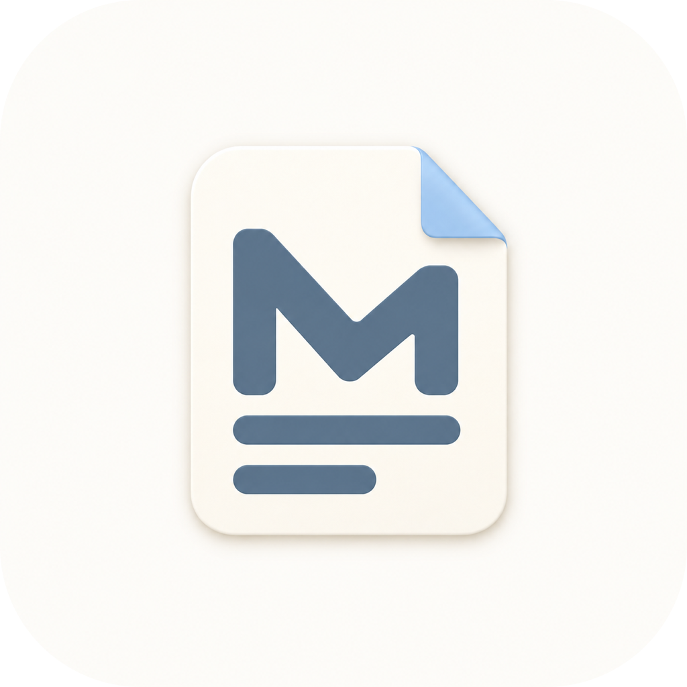
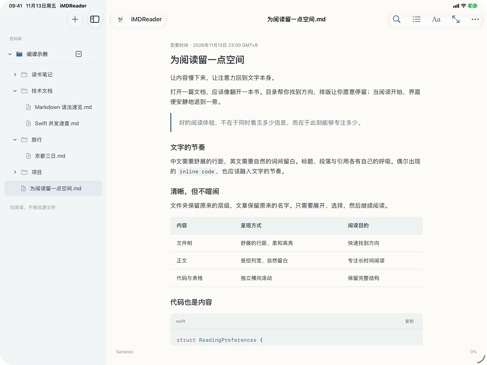
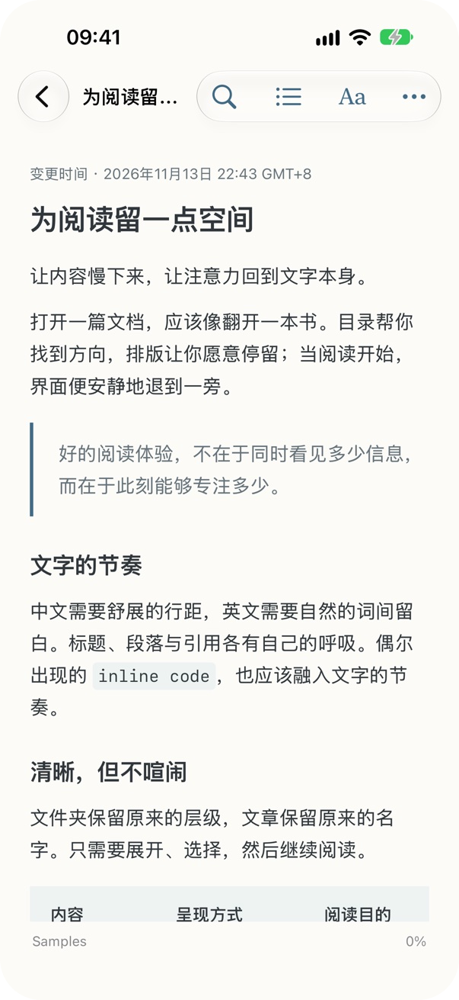
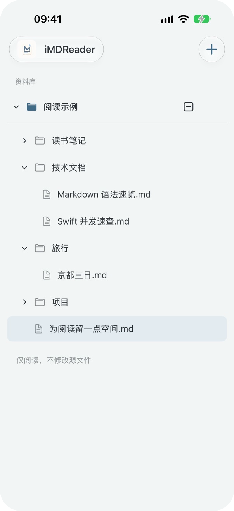
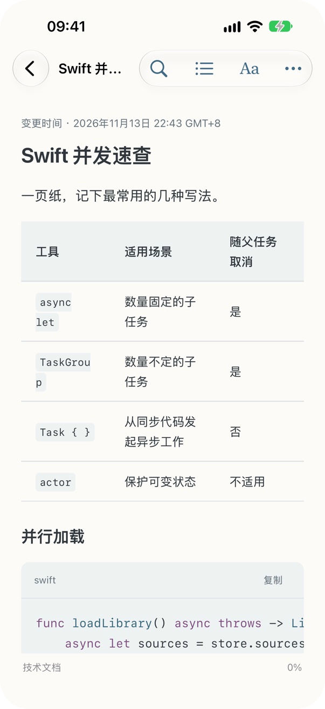
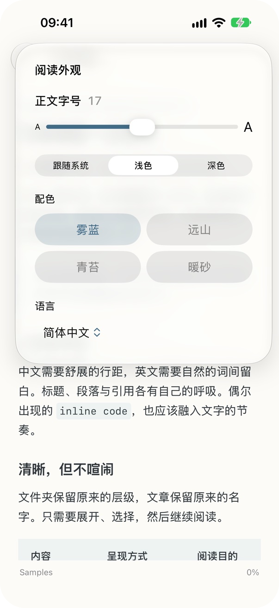
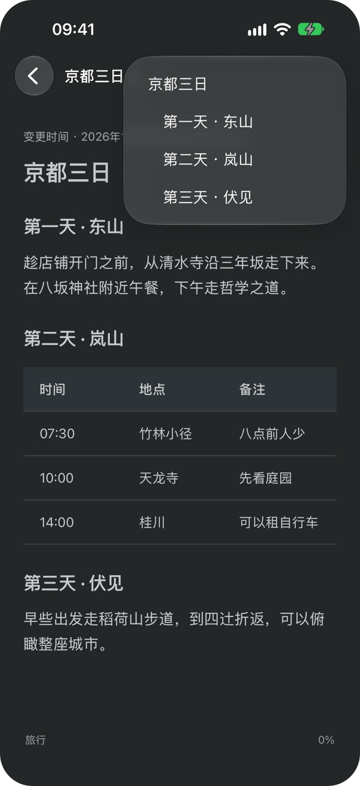
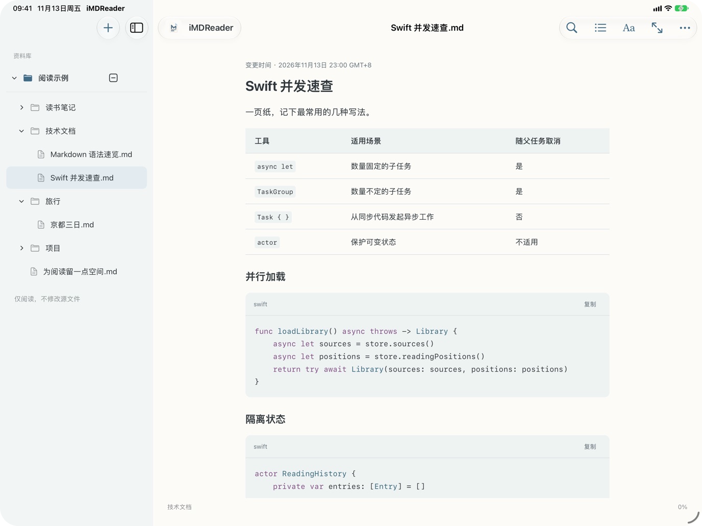
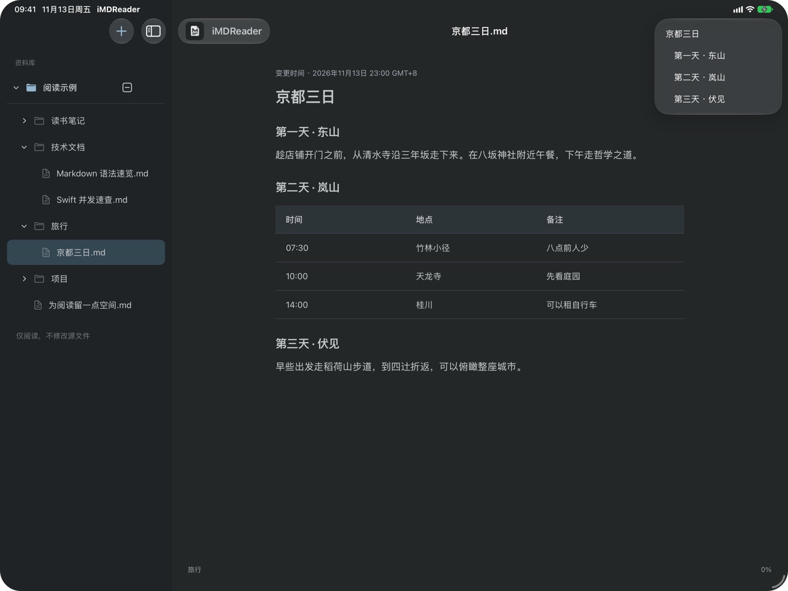

<h1 align="center">iMDReader</h1>

简体中文 · <a href="README.en.md">English</a>

<b>为阅读，留一点空间。</b> 轻量、原生、只读的 Markdown 阅读器，适用于 Mac、iPhone 和 iPad。 完全免费，没有内购，不收集任何数据。

<a href="https://github.com/wivnelo/i-md-reader/releases/tag/v0.4.0">Mac 下载 0.4.0</a> · <a href="https://apps.apple.com/app/id6827371085">App Store</a> · <a href="https://wivnelo.github.io/i-md-reader/">官网</a>

## 下载

| 平台 | 版本 | 系统要求 |
| --- | --- | --- |
| **Mac** | [0.4.0 正式版](https://github.com/wivnelo/i-md-reader/releases/tag/v0.4.0)（2026-11-13） | macOS 14 或更高版本，Apple Silicon 与 Intel |
| **iPhone / iPad** | [App Store 0.3.0](https://apps.apple.com/app/id6827371085)（2026-11-11）；0.4.0 已提交审核 | iOS / iPadOS 17 或更高版本 |

Mac 推荐下载 `.dmg`，打开后将 iMDReader 拖入“应用程序”；也可下载 ZIP。发行包已通过 Developer ID 签名、Apple 公证和 Gatekeeper 检查。更新时先退出 iMDReader，直接替换即可，资料库会保留；若 Dock 仍打开旧版，移除旧图标，再从“应用程序”重新固定。

## 预览

 

以上为 0.4.0 模拟器实拍（iPhone 18 Pro、iPad Pro 13 英寸），文档为示例内容：阅读页、资料库、代码与表格、阅读外观、深色模式与文章目录。

## 开始阅读

1. 点击 **＋**，选择 Markdown 文件、本地文件夹或 GitHub 链接。
2. 选择文档开始阅读；添加文件夹可保留目录层级和文档间的相对链接。
3. 用搜索、文章目录和 **Aa** 调整阅读方式；阅读位置会自动保存。

单独授权的文件不会自动授权其所在文件夹；如需读取同级图片或文档，请添加整个文件夹。iMDReader 只读取内容，不修改、移动或删除源文件。

## 功能

### 阅读

- 标题、表格、任务列表、引用、图片和代码块，支持代码高亮（含 MATLAB）与一键复制。
- 文内查找、文章目录，阅读位置按段落记住，换设备或改变窗口宽度后回到原处。
- 字号 12–26pt、浅色 / 深色 / 跟随系统，四套阅读配色。
- README 中常见的 HTML（居中标题、徽章、`
` 折叠等）按 GitHub 方式安全渲染，HTTPS 网络图片直接显示。
- 顺手查看仓库里的源码和配置文件（Swift、Python、JavaScript/TypeScript、Go、Rust、C 系、JSON、YAML 等）：只读、带行号与语法高亮。

### 来源

- 单篇 Markdown、本地文件夹、GitHub 仓库 / 子目录 / 单篇文档，保留原有目录层级。
- 常读来源置顶，其余顶层来源可排序；移除来源只删除阅读器里的引用，不碰原文件。
- 私有 GitHub 仓库可使用你自己的细粒度只读令牌，保存在设备 Keychain；所有请求均为只读。
- 读过的 GitHub 内容可离线阅读；缓存不等于整仓下载，未缓存的内容仍需网络。

### 同步与系统集成

- **iCloud 同步：** 同一 Apple 账户的设备间同步来源、置顶与排序和阅读位置，可在“•••”中关闭。存于你的私有 iCloud，不上传文档正文和令牌；外观设置各设备独立。
- **iPhone / iPad：** “继续阅读”主屏小组件、Spotlight 搜索已读文章、快捷指令与 Siri（“继续阅读”“打开文档”）。
- **Mac：** Universal 原生应用，右键置顶或移除来源，离线缓存自动管理。

### 语言与隐私

- 界面语言：简体中文、繁體中文、English、日本語、한국어，可在“阅读外观”中随时切换（Mac 0.4.0 起；App Store 0.3.0 为简体中文和 English）。文档内容与文件名保持原样。
- 完全免费，没有内购、广告或账号；不收集任何数据，不执行文档中的代码。

## 帮助与反馈

[使用支持](https://wivnelo.github.io/i-md-reader/support.html) · [隐私政策](https://wivnelo.github.io/i-md-reader/privacy.html) · [提交问题](https://github.com/wivnelo/i-md-reader/issues)

**0.4.0 更新：** 新增日本語、한국어和繁體中文；iCloud 同步更稳定，未登录 iCloud 或关闭同步时不再影响启动；分屏或台前调度改变窗口宽度后仍回到原来的段落；图片说明随所选语言显示。Mac 0.4.0 已于 2026-11-13 发布，iPhone / iPad 0.4.0 已提交 App Store 审核，上架前商店版本仍为 0.3.0。开发进展与验收边界见 [开发状态](docs/STATUS.md)。
