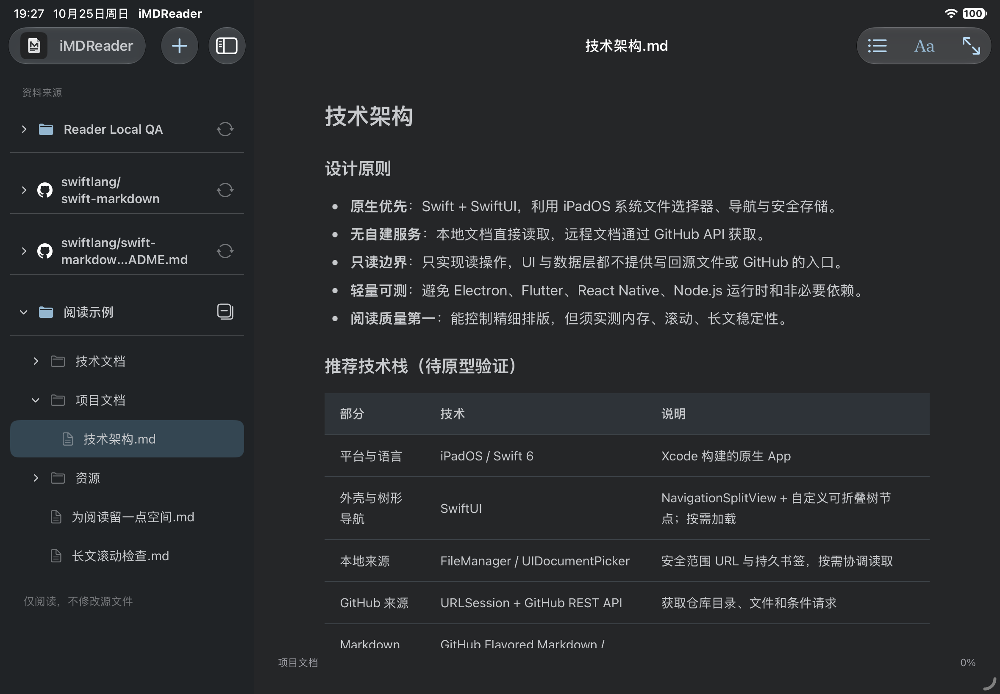

# iMDReader

轻量、原生、只读的 Markdown 阅读器，支持 Mac、iPad 和 iPhone。

**Mac正式版：0.2.1（51）**。Universal支持Apple Silicon与Intel，最低macOS14；App和DMG均已通过Developer ID签名、Apple公证、staple及Gatekeeper检查。iPhone/iPad已完成本机开发安装验收，尚未在App Store发行。

[下载0.2.1](https://github.com/wivnelo/i-md-reader/releases/tag/v0.2.1) · [版本状态与验证边界](docs/STATUS.md) · [历史0.2.0](https://github.com/wivnelo/i-md-reader/releases/tag/v0.2.0)

推荐下载DMG，打开后将iMDReader.app拖入Applications覆盖旧版，保留资料库；另提供ZIP与SHA256SUMS.txt。

## 0.2.1更新

- 正文标题上方只显示一个“变更时间”：本地文件修改时间，或GitHub当前阅读版本的最近提交；缺值省略。
- 阅读示例可移除，重启不再恢复，不删除源文件。
- 移动源码包含iPad顶栏调整和隐私政策入口，商店分发仍在准备。

三端51已获用户验收确认，功能冻结；非P0改进留待后续版本。Intel和最低系统实机运行未覆盖，完整边界见STATUS。



*原生模拟器截图。截图保留当时状态，最新代码已进一步简化“收起全部”图标。*

## 已实现

- **单个文件**：App 内选择 Markdown，或从系统“文件 → 打开方式 → iMDReader”进入；独立书签、最近文件和严格文件权限边界。
- **本地文件夹**：系统目录选择、多来源、原层级懒加载树、安全范围书签及状态恢复；只读原文件。
- **GitHub**：公开仓库及持有细粒度只读令牌的选定私有仓库、子目录、单篇 Markdown 链接；分支解析、固定提交读取、相对 Markdown 导航及每来源刷新。
- **阅读**：GFM、表格、任务列表、代码高亮/复制、本地和GitHub相对位图、MATLAB等代码块高亮、文章目录、阅读位置、隐藏侧栏。
- **外观**：浅色/深色、四套低饱和配色；默认 17pt，字号滑杆以 17pt 为中点（范围 12–26pt）。
- **来源管理**：根标题吸顶、Mac右键移除/移动端左滑移除、未置顶的顶层长按排序并保存顺序、始终展开的置顶分组、收起全部子目录、无障碍上移/下移；移除来源不删除源文件。
- **界面语言**：跟随系统、简体中文、English；保存选择，不翻译文档正文或文件名。
- **刷新保护**：并发请求合并、固定提交响应的受限内存缓存、限流冷却和恢复时间提示。

本期已交付功能用户确认通过；完整平台、异常、性能与无障碍检查按后续计划单独记录。

## 0.2.0 更新

- Mac 顶层来源右键移除，置顶分组三端始终展开；目录树隐藏所有层级点前缀条目。
- Mac 固定深色图标；启动检查正式更新，点击下载后手动安装。
- Mac 查找去蓝框，GitHub授权/添加弹窗修复裁切，添加菜单向下展开避开品牌。
- Mac 保留自动缓存并取消缓存设置；移动端缓存页精简说明。
- 移动窄屏配色去除重复底色；iPad 品牌与独立加号固定在侧栏顶部。

## 下一阶段与专项检查

- 移动端继续完成商店签名、截图与必需声明；本轮功能冻结，非P0改进延期。完整状态以STATUS为准。

- Mac主要GitHub、书签恢复、系统文件冷热打开和搜索已完成检查；剩余窗口专项及移动端待决定事项见STATUS。
- 图片放大、外部HTTPS图片和SVG安全加载。
- 最低系统、VoiceOver/动态字号、其他文件提供方/组织授权异常、长文与多图性能和分发检查。

本期已交付功能按用户整体确认收口；专项检查不被整体使用反馈自动代替。见[阶段总结](docs/STAGE_2026-10-26.md)。

不开发编辑器、Git 提交/推送、AI、协作或自建服务。

入口：“＋”直接添加MD文件、本地文件夹、GitHub链接；阅读区右上“•••”管理授权，移动端另保留离线缓存设置；Aa管理阅读外观及语言。

## 构建与测试

使用 Xcode 打开 `iMDReader.xcodeproj`，选择共享方案 `iMDReader`。首轮构建需下载 Swift 官方 Markdown/cmark 依赖，版本记录在 `Package.resolved`。Mac 使用同工程共享方案 `iMDReaderMac`，原生 AppKit/WebKit，不使用 Catalyst。Mac 最低目标为 macOS 14（尚未在该系统实测），Debug 默认本机架构。暂定 iOS/iPadOS 17 下限，尚未完成该版本的运行验收；已使用 Xcode 27.1 构建。

```sh
# 核心解析、路径、GitHub 请求测试
swift test --package-path ReaderCore
# macOS 上直接测试实际 ReaderStore
swift test
# 不签名的模拟器构建
xcodebuild -project iMDReader.xcodeproj -scheme iMDReader \
  -destination 'generic/platform=iOS Simulator' CODE_SIGNING_ALLOWED=NO build
```

首次实机安装需要在 Xcode 配置自己的开发团队和唯一 Bundle ID；已有安装必须沿用原团队与标识，不卸载清空数据。仓库不包含签名证书或个人团队参数。首次选择本地目录需要系统授权。

真实网络测试默认跳过，可在确有需要时显式设置 `READER_GITHUB_LIVE=1`，注意 GitHub 请求额度。

## 技术与安全边界

Swift 6 / SwiftUI `NavigationSplitView` + `WKWebView`。swift-markdown（cmark-gfm）解析为安全白名单 HTML，highlight.js 随应用离线内置。原始 HTML 不直接执行，资源路径检查授权边界，WebKit 禁止文档脚本和网络直连。

GitHub不复用开发机登录；可在App内保存细粒度访问令牌到Keychain，请求限定GitHub API、只发GET并拒绝重定向。内存缓存上限32 MB / 128项，另有默认128 MB / 512项磁盘缓存，支持已读GitHub内容重启离线阅读，见[离线缓存与高亮](docs/OFFLINE_CACHE.md)。远程正文暂限 UTF-8 / 10 MB，本地图片文件暂限 20 MB；这些是保护上限，不是性能保证。

第三方声明见 [ThirdPartyNotices](ReaderApp/Resources/ThirdPartyNotices.txt)、[highlight.js 来源与许可](ReaderApp/Resources/Vendor/README.md) 及 [GitHub 来源标识说明](ReaderApp/Resources/GitHubMark-Attribution.md)。GitHub 标识仅用于辨识来源，不是本应用图标。

## 项目入口

- [阶段一总结与固定决策](docs/STAGE_2026-10-26.md)
- [开发状态与后续计划](docs/STATUS.md)
- [单文件打开与默认应用设计](docs/FILE_OPENING.md)
- [原生运行截图](design/previews/README.md)
- [App 图标说明](design/app-icon/README.md)
- `ReaderApp/`：原生界面、阅读桥接、来源与状态。
- `ReaderCore/`：安全解析、文件边界、GitHub 只读请求及核心测试。
- `Tests/`：实际应用状态的 macOS 测试。
- `design/`：早期视觉原型、配色比较与历史截图；不作为当前实现状态的依据。

当前文档支持工具栏关键词查找与 ⌘F；最近文件支持一键清空记录，源文件保留。具体验证范围见 [开发状态](docs/STATUS.md)。

### Mac 构建

```sh
xcodebuild -project iMDReader.xcodeproj -scheme iMDReaderMac \
  -configuration Release -destination 'generic/platform=macOS' \
  ONLY_ACTIVE_ARCH=NO 'ARCHS=arm64 x86_64' \
  CURRENT_PROJECT_VERSION=27 MARKETING_VERSION=0.1.0 \
  CODE_SIGNING_ALLOWED=NO build
```

上例仅构建源码，不生成可分发签名。正式分发需使用自己的Developer ID身份、可信时间戳和hardened runtime，并完成公证/staple/Gatekeeper检查；Mac Release禁用自动注入调试权限，不允许get-task-allow。签名团队和凭据不写入仓库。

原生视图检查使用指定Mac包的真实英文资源，隐藏测试窗口，不修改系统外观：

```sh
bash scripts/check-mac-appearance.sh /path/to/iMDReader.app
```

版本、功能验证、未测范围及后续计划统一维护在 [STATUS](docs/STATUS.md)。
